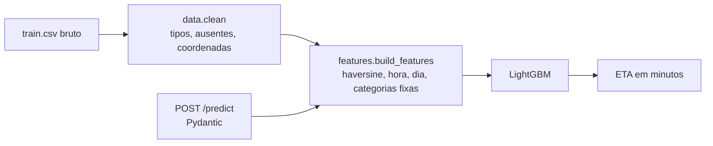

# ETA de entregas

Modelo que prevê o tempo de entrega de um pedido de delivery a partir de distância, horário, clima, trânsito e perfil do entregador, servido por uma API FastAPI com validação de entrada, testes e CI.

[](https://github.com/krosct/project-nov26-p1-eta/actions/workflows/ci.yml)

## Resultados

Validação cruzada com `GroupKFold` (5 folds, agrupado por `Delivery_person_ID`) em 36.612 pedidos; teste final em 8.981 pedidos de IDs não vistos no treino; teste temporal (*out-of-time*) treinando nos primeiros 80% **dos dias** (até 28/03/2022) e testando nos 9 dias seguintes (9.447 pedidos). O **modelo principal não usa a nota do entregador** (ver Decisões): ela pode ser a avaliação da própria entrega e só existir depois dela.

| Modelo | MAE (min) | RMSE (min) | R² |
|---|---|---|---|
| Baseline: média | 7,59 | 9,38 | 0,00 |
| Baseline: regressão linear | 5,14 | 6,47 | 0,52 |
| **LightGBM (CV 5-fold agrupado)** | **3,39 ± 0,02** | **4,23** | **0,80** |
| LightGBM — teste final (IDs inéditos) | **3,42** (IC95 3,36–3,47) | 4,27 | 0,80 |
| LightGBM — teste temporal (*out-of-time*) | **3,45** | 4,28 | 0,80 |
| *Sensibilidade: LightGBM com a nota do entregador (CV)* | *3,13* | *3,95* | *0,82* |
| *Sensibilidade: com a nota — teste final* | *3,16* | *3,99* | *0,82* |

O erro médio caiu de 7,6 para 3,4 minutos (−55% em relação à média e −34% em relação ao modelo linear). CV, teste final e teste temporal dão MAE parecido (3,39 / 3,42 / 3,45): o resultado é **estável**, mas isso não prova ausência de vazamento, porque um vazamento dentro de uma feature afetaria os três do mesmo jeito. Por isso a nota, a feature suspeita, foi retirada e medida à parte.


## Como funciona



- **`data.py`** corrige os problemas do CSV original: ausentes gravados como o texto `"NaN "`, espaços residuais, alvo como `"(min) 24"`, coordenadas com sinal invertido ou zeradas e notas acima de 5. Detalhes em [`data/README.md`](data/README.md) e na [EDA](notebooks/01-eda.ipynb).
- **`features.py`** calcula a distância haversine, a hora e o dia da semana do pedido e fixa as categorias. A mesma função é usada no treino e na API, então não há divergência entre os dados de treino e os de produção.
- **`api.py`** valida a entrada (faixas de latitude, categorias permitidas, idade de 15 a 70) e devolve 422 para pedidos inválidos. A API não recebe a nota do entregador.

## Como rodar

```bash
uv sync --group train                                   # dependências (inclui MLflow)
uv run --group train python scripts/train.py            # treina, avalia e salva models/modelo.joblib
uv run uvicorn project_nov26_p1_eta.api:app             # API em http://127.0.0.1:8000/docs
```

Os dados não são versionados; veja como baixar em [`data/README.md`](data/README.md). Para ver os experimentos: `uv run --group train mlflow ui --backend-store-uri sqlite:///mlflow.db`.

```bash
curl -X POST localhost:8000/predict -H "Content-Type: application/json" -d '{
  "restaurante_lat": 22.745049, "restaurante_lon": 75.892471,
  "entrega_lat": 22.765049, "entrega_lon": 75.912471,
  "data_pedido": "2022-03-19", "hora_pedido": "11:30:00",
  "clima": "Sunny", "transito": "High", "tipo_pedido": "Snack",
  "veiculo": "motorcycle", "condicao_veiculo": 2, "cidade": "Urban",
  "idade_entregador": 37, "entregas_multiplas": 0
}'
# {"eta_min": 18.6}
```

Docker (depois de treinar): `docker build -t eta-p1 . && docker run -p 8000:8000 eta-p1`.

## Decisões e trade-offs

- **Vazamento:** `Time_Order_picked` (hora da retirada) é uma das variáveis mais usadas em notebooks públicos desse dataset, mas só existe depois que o pedido sai do restaurante. Ela foi excluída das features.
- **Nota do entregador fora do modelo principal:** é a feature de maior ganho (MAE 3,39 → 3,13 ao incluí-la) e tem correlação −0,34 com o tempo. Mas ela **muda pedido a pedido dentro do mesmo ID** (desvio dentro do ID 0,31 contra 0,33 no total) e ainda explica parte do resíduo do modelo sem ela (correlação −0,20). Isso é compatível com uma nota dada à própria entrega, que só existe depois dela, o mesmo problema de `Time_Order_picked`. Descrições de terceiros do dataset dizem apenas que é a "média das avaliações de clientes recebidas pelo entregador" (a página oficial do Kaggle não pôde ser consultada), o que contradiz o fato de variar dentro do ID e não esclarece se é conhecida antes do pedido. Não há como provar com estes dados, e sem garantia de que a nota é conhecida na hora do pedido, ela fica fora (diagnóstico em [`reports/diagnostico_dados.json`](reports/diagnostico_dados.json), `scripts/diagnostico.py`). Se a plataforma tiver a nota histórica do entregador *antes* do pedido, o modelo com nota (linhas em itálico) é o relevante.
- **`Delivery_person_ID` não é uma pessoa estável:** dentro do mesmo ID a mediana é de 17 idades e 9 notas diferentes (1.320 IDs, 34,5 pedidos por ID). O `GroupKFold` por ID foi mantido por cautela, mas não muda a métrica: MAE de CV 3,39 agrupado e 3,39 com split aleatório. Por isso "entregadores inéditos" vale só no sentido de "IDs inéditos", e idade e nota devem ser lidas como atributos do pedido, não de uma pessoa.
- **Ausentes mantidos:** ~16% dos pedidos têm algum ausente, e são, em média, entregas mais rápidas. Descartá-los enviesaria a base. O LightGBM trata ausentes nativamente; no modelo linear, a imputação fica dentro do pipeline, ajustada só nos dados de treino de cada fold.
- **Quanto custa não ter cada informação** (CV agrupado, sem a nota):

  | Experimento | MAE (min) |
  |---|---|
  | Modelo principal | 3,39 |
  | Sem `multiple_deliveries` | 3,51 (+0,12) |
  | Sem idade do entregador | 4,36 (+0,97) |

  A idade é a informação do entregador mais valiosa do modelo principal. `multiple_deliveries` só é conhecida após a atribuição do entregador; o modelo assume que o ETA é calculado nesse momento, e o custo de não tê-la é pequeno (+0,1 min).
- **MAE como métrica principal:** está em minutos, é interpretável ("erramos 3,2 min em média") e é menos sensível a poucos atrasos extremos. RMSE e R² são reportados para comparação com outros trabalhos. O teste final tem IC95 do MAE por bootstrap dos pedidos.

## Limitações e próximos passos

- Distância em **linha reta**; a distância por rota (OSRM/Google Maps) deve reduzir o erro em entregas longas.
- **O dataset tem sinais de dado gerado:** idade e nota variam dentro do mesmo ID, a contagem diária de pedidos alterna entre ~970 e ~1.150 em dias consecutivos sem padrão por dia da semana, e há 11 dias sem pedidos entre 11/02 e 06/04 (19/02 a 28/02). As métricas valem para este dataset, não para a operação real.
- Dados de 44 dias em cidades da Índia; séries mais longas permitiriam capturar sazonalidade anual e monções. No teste temporal, os IDs se repetem entre treino e teste.
- Sem intervalo de confiança: uma regressão quantílica (p10/p90) permitiria prometer prazos com margem.
- Sem monitoramento de *drift*: em produção, comparar a distribuição das features e do erro por semana.
