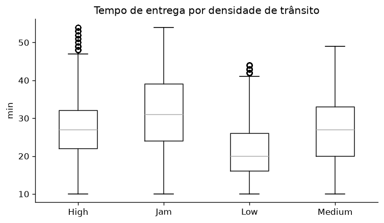
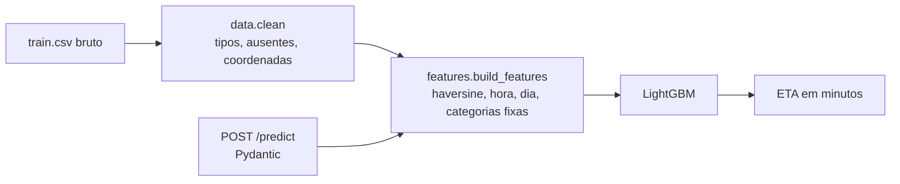

# ETA de entregas

Modelo que prevê o tempo de entrega de um pedido de delivery a partir de distância, horário, clima, trânsito e perfil do entregador, servido por uma API FastAPI com validação de entrada, testes e CI.

[](https://github.com/krosct/project-nov26-p1-eta/actions/workflows/ci.yml)

## Resultados

Validação cruzada com `GroupKFold` (5 folds, agrupado por entregador) em 36.612 pedidos; teste final em 8.981 pedidos de **entregadores nunca vistos no treino**.

| Modelo | MAE (min) | RMSE (min) | R² |
|---|---|---|---|
| Baseline: média | 7,59 | 9,38 | 0,00 |
| Baseline: regressão linear | 4,83 | 6,08 | 0,58 |
| **LightGBM** | **3,13 ± 0,02** | **3,95** | **0,82** |
| LightGBM — teste final | **3,16** | 3,99 | 0,82 |

O erro médio caiu de 7,6 para 3,2 minutos (−58% em relação à média e −35% em relação ao modelo linear). O MAE do teste final é praticamente igual ao da validação cruzada, um bom indício de que não há vazamento.



## Como funciona



- **`data.py`** corrige os problemas do CSV original: ausentes gravados como o texto `"NaN "`, espaços residuais, alvo como `"(min) 24"`, coordenadas com sinal invertido ou zeradas e notas acima de 5. Detalhes em [`data/README.md`](data/README.md) e na [EDA](notebooks/01-eda.ipynb).
- **`features.py`** calcula a distância haversine, a hora e o dia da semana do pedido e fixa as categorias. A mesma função é usada no treino e na API, então não há divergência entre os dados de treino e os de produção.
- **`api.py`** valida a entrada (faixas de latitude, categorias permitidas, nota de 1 a 5) e devolve 422 para pedidos inválidos.

## Como rodar

```bash
uv sync --group train                                   # dependências (inclui MLflow)
uv run --group train python scripts/train.py            # treina, avalia e salva models/modelo.joblib
uv run uvicorn project_nov26_p1_eta.api:app             # API em http://127.0.0.1:8000/docs
```

Os dados não são versionados; veja como baixar em [`data/README.md`](data/README.md). Para ver os experimentos: `uv run --group train mlflow ui --backend-store-uri sqlite:///mlflow.db`.

```bash
curl -X POST localhost:8000/predict -H "Content-Type: application/json" -d '{
  "restaurante_lat": 22.745049, "restaurante_lon": 75.892471,
  "entrega_lat": 22.765049, "entrega_lon": 75.912471,
  "data_pedido": "2022-03-19", "hora_pedido": "11:30:00",
  "clima": "Sunny", "transito": "High", "tipo_pedido": "Snack",
  "veiculo": "motorcycle", "condicao_veiculo": 2, "cidade": "Urban",
  "idade_entregador": 37, "nota_entregador": 4.9, "entregas_multiplas": 0
}'
# {"eta_min": 18.6}
```

Docker (depois de treinar): `docker build -t eta-p1 . && docker run -p 8000:8000 eta-p1`.

## Decisões e trade-offs

- **Vazamento:** `Time_Order_picked` (hora da retirada) é uma das variáveis mais usadas em notebooks públicos desse dataset, mas só existe depois que o pedido sai do restaurante. Ela foi excluída das features.
- **Validação agrupada por entregador:** há 1.320 entregadores com cerca de 35 pedidos cada. Com um split aleatório, o modelo reconheceria o entregador e a métrica ficaria otimista. Com `GroupKFold` e um teste final agrupado, todo entregador avaliado é inédito.
- **Ausentes mantidos:** ~16% dos pedidos têm algum ausente, e são, em média, entregas mais rápidas. Descartá-los enviesaria a base. O LightGBM trata ausentes nativamente; no modelo linear, a imputação fica dentro do pipeline, ajustada só nos dados de treino de cada fold.
- **Quanto custa não ter cada informação:**

  | Experimento | MAE (min) |
  |---|---|
  | Todas as features | 3,13 |
  | Sem `multiple_deliveries` | 3,23 (+0,10) |
  | Sem idade e nota do entregador | 4,36 (+1,23) |

  O perfil do entregador é a informação mais valiosa (a nota é a feature de maior ganho no modelo). Para **entregadores novos, sem nota**, o erro esperado sobe para algo próximo de 4,4 min. Em produção, valeria um modelo específico para esse caso. `multiple_deliveries` só é conhecida após a atribuição do entregador; o modelo final assume que o ETA é calculado nesse momento, e o custo de não tê-la é pequeno (+0,1 min).
- **MAE como métrica principal:** está em minutos, é interpretável ("erramos 3,2 min em média") e é menos sensível a poucos atrasos extremos. RMSE e R² são reportados para comparação com outros trabalhos.

## Limitações e próximos passos

- Distância em **linha reta**; a distância por rota (OSRM/Google Maps) deve reduzir o erro em entregas longas.
- Dados de 44 dias em cidades da Índia; a validação temporal (treinar nas primeiras semanas e testar nas últimas) seria um complemento natural.
- Sem intervalo de confiança: uma regressão quantílica (p10/p90) permitiria prometer prazos com margem.
- Sem monitoramento de *drift*: em produção, comparar a distribuição das features e do erro por semana.
